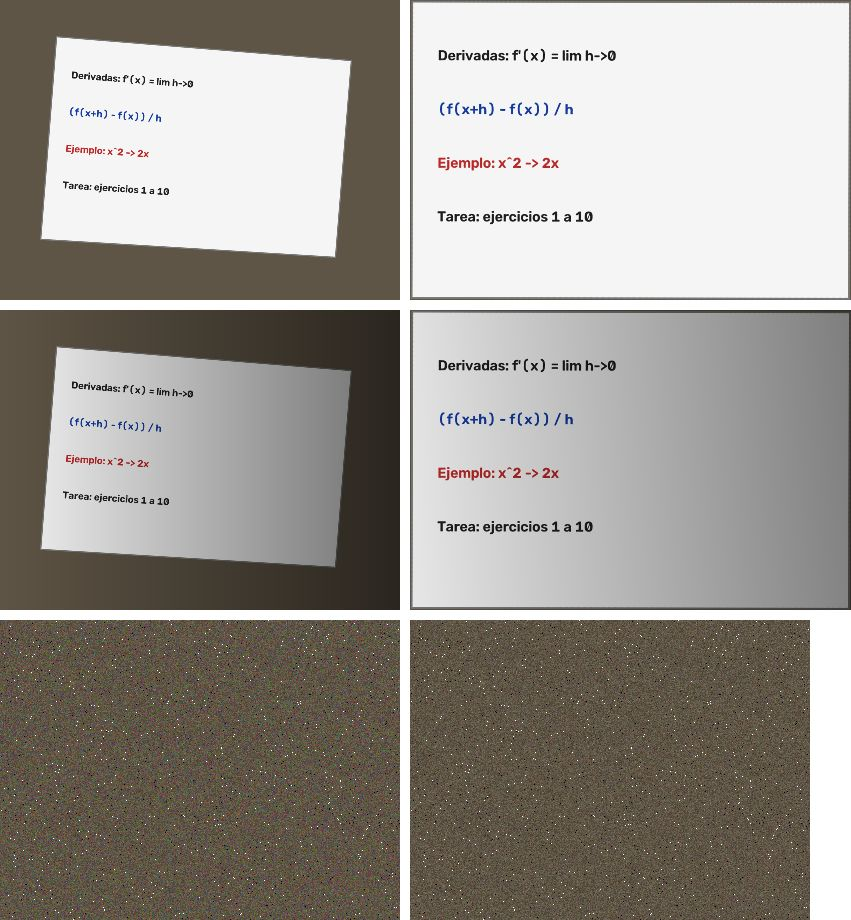
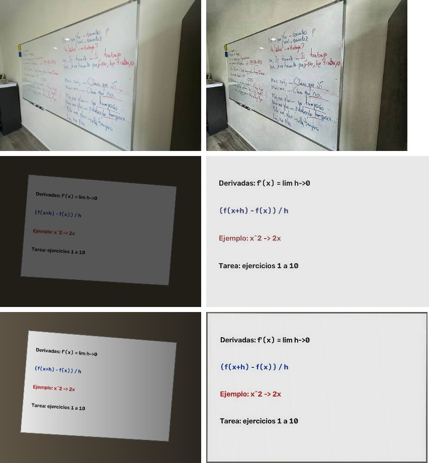
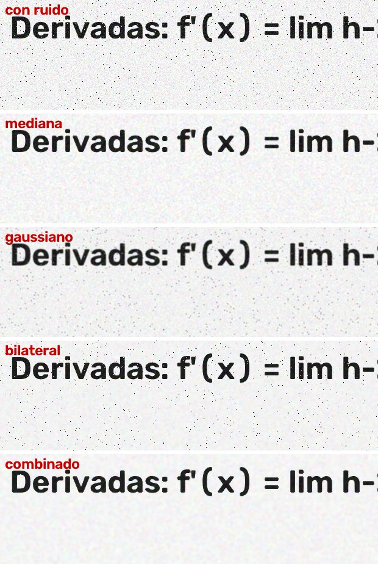

# Backend – Motor de imágenes (FastAPI)

## Estructura

```
back/motori_magenes/
├── main.py                 # Punto de entrada: uvicorn main:app --reload
├── index.py                # Compatibilidad con el antiguo "uvicorn index:app"
├── requirements.txt        # Dependencias del backend
├── .env.example            # Plantilla de variables de entorno (copiar a .env)
└── app/
    ├── main.py             # create_app(): instancia FastAPI, CORS y routers
    ├── core/
    │   └── config.py       # Configuración leída de variables de entorno / .env
    ├── routers/            # Rutas HTTP (solo reciben y responden)
    │   ├── general.py      # GET  /
    │   └── imagenes.py     # POST /analisis, POST /imagen-memoria
    ├── core/errores.py     # ApiError y respuesta JSON de error común
    └── services/           # Lógica reutilizable, sin dependencias de rutas
        ├── validacion.py       # Validación de la imagen recibida (BACK-02)
        └── procesamiento.py    # Pipeline de OpenCV (BACK-03 en adelante)
```

## Rutas disponibles

| Método | Ruta              | Descripción                                                     |
|--------|-------------------|-----------------------------------------------------------------|
| GET    | `/`               | Comprobación de estado. Responde `{"message": "Hola Mundo"}`.   |
| GET    | `/salud`          | Estado del servicio, versión y límites vigentes.                |
| POST   | `/analisis`       | Recibe `file` (multipart), lo valida y lo devuelve procesado.   |
| POST   | `/imagen-memoria` | Devuelve una imagen PNG de ejemplo generada en memoria.         |

Las rutas y sus respuestas no cambiaron, por lo que `front/js/fastapi.js`
sigue funcionando contra `http://localhost:8000/analisis`.

## Variables de entorno

| Variable       | Por defecto                    | Uso                                                  |
|----------------|--------------------------------|------------------------------------------------------|
| `MAX_UPLOAD_MB` | `10`                          | Tamaño máximo del archivo recibido.                  |
| `MAX_MEGAPIXELES` | `50`                        | Resolución máxima de la imagen recibida.             |
| `CORS_ORIGINS` | `*`                            | Orígenes permitidos, separados por comas.            |
| `APP_NAME`     | `ApuntIA - Motor de imágenes`  | Título mostrado en `/docs`.                          |

```bash
cp .env.example .env
```

## Ejecución

```bash
pip install -r requirements.txt
```

```bash
uvicorn main:app --reload
```

## Cómo comprobarlo

```bash
curl http://127.0.0.1:8000/
```

```bash
curl -X POST -F "file=@../bd/img/image.png" http://127.0.0.1:8000/analisis -o resultado.png
```

También puede probarse desde `http://127.0.0.1:8000/docs`.

## Validación de imágenes (BACK-02)

El contrato completo está en [`docs/api.md`](../../docs/api.md). `POST /analisis` comprueba, en este orden:

1. Que exista el campo `file` → si no, `400 ARCHIVO_AUSENTE`.
2. Que no esté vacío → si lo está, `400 ARCHIVO_VACIO`.
3. Que no supere `MAX_UPLOAD_MB` → si lo supera, `413 ARCHIVO_DEMASIADO_GRANDE`. Se leen como máximo `límite + 1` bytes.
4. Que su **firma binaria** sea JPEG, PNG o WEBP; la extensión y el `Content-Type` no bastan → si no, `415 TIPO_NO_PERMITIDO`.
5. Que no supere `MAX_MEGAPIXELES`, leyendo solo la cabecera → si la supera, `413 IMAGEN_DEMASIADO_GRANDE`.
6. Que OpenCV pueda decodificarla → si no puede, `400 IMAGEN_CORRUPTA`.

Todo ocurre en memoria: ya no se escriben archivos en disco, por lo que desaparece la variable `IMAGES_DIR`. El nombre recibido se limpia antes de usarlo en las cabeceras de la respuesta.

## Pipeline de procesamiento (BACK-03)

`app/services/procesamiento.py` no depende de FastAPI: trabaja con matrices NumPy en BGR `uint8`.

```python
from app.services.procesamiento import procesar, codificar_png, OpcionesProcesamiento

resultado = procesar(imagen_bgr, OpcionesProcesamiento(grises=True))
png = codificar_png(resultado.imagen)
resultado.tiempos_ms        # {"copia": 0.4, "grises": 1.2, ...}
resultado.perspectiva       # "corregida" | "no_detectada" | "desactivada"
```

- **Decodificación:** `cv2.imdecode`, dentro de la validación (BACK-02). Las imágenes en gris o con canal alfa se normalizan a BGR.
- **Orden fijo de etapas:** `construir_etapas()` devuelve las etapas activas en orden. Cada una mide su tiempo y, si OpenCV falla, se convierte en `ProcesamientoError` (500).
- **El original no se modifica:** el pipeline trabaja sobre una copia.
- **Salida:** PNG sin pérdida, devuelto directamente en la respuesta con las cabeceras `X-ApuntIA-*` del contrato.

## Corrección de perspectiva (BACK-04)

`app/services/perspectiva.py`, activada por defecto (`?perspectiva=false` la desactiva):

1. La detección se hace sobre una copia reducida (lado mayor ≤ 800 px); las esquinas se reescalan al original.
2. Se buscan cuadriláteros con dos métodos: **bordes de Canny** dilatados y **umbral de Otsu**, este último para pizarrones claros sobre pared oscura o fotos con poca luz.
3. Un candidato solo se acepta si es **fiable**: 4 vértices, convexo, entre el 10 % y el 98 % del área, ángulos interiores de 45° a 135°, proporción de lados ≤ 6 y como mucho una esquina pegada al borde de la foto.
4. Las esquinas se ordenan (sup-izq, sup-der, inf-der, inf-izq) y se aplica `warpPerspective`. El tamaño de salida es la media de los lados opuestos, así se conservan las proporciones.
5. Si no hay un candidato fiable, se devuelve la imagen sin cambios con `X-ApuntIA-Perspectiva: no_detectada`. **No es un error.**

Resultados con las muestras de `herramientas/muestras.py` (`python -m herramientas.muestras ../bd/muestras`):

| Muestra | Resultado | Error máx. de esquinas |
|---------|-----------|------------------------|
| Inclinada / con sombra / con ruido | `corregida` (bordes) | 4 px en 1600×1200 |
| Oscura | `corregida` (umbral) | — |
| Pizarrón pequeño (~16 % de la foto) | `corregida` | 6 px |
| Frontal (el pizarrón ocupa toda la foto) | `no_detectada`: no hace falta corregir | — |
| Sin pizarrón / 20 fondos de ruido | `no_detectada`, 0 falsos positivos | — |
| Foto real `bd/img/image.png` | `no_detectada` | — |



**Limitación conocida:** en la foto real `bd/img/image.png` el pizarrón **se sale del encuadre** por arriba y por abajo, y es blanco sobre pared blanca, así que no hay cuatro esquinas visibles. Se devuelve sin rectificar en lugar de deformarla con un cuadrilátero falso. Para estos casos, una mejora futura sería intersecar las rectas del marco (Hough).

## Calidad y nitidez (BACK-05)

`app/services/mejora.py`, activada por defecto (`?mejorar=false` la desactiva). Trabaja solo sobre el canal **L de LAB**, así que los colores de los marcadores se conservan.

| Paso | Cuándo | Parámetros |
|------|--------|------------|
| Gamma automática | L medio < 105 (foto oscura) | Lleva la luminancia media al 50 %, con gamma entre 0.4 y 1 |
| Normalización de iluminación | Solo si la perspectiva se **corrigió** | Fondo = cierre morfológico de tamaño lado/40 + desenfoque; L = L / fondo × 235 |
| CLAHE | Si **no** se normalizó la iluminación | clipLimit 2.0, rejilla 8×8 |
| Máscara de enfoque | Siempre | cantidad 0.6, sigma = max(0.8, lado/1500) |

Comparación con `python -m herramientas.evaluar_mejora`. Contraste = diferencia media de L entre el fondo y el texto; más alto es más legible. «En sombra» es la franja del 45 % al 75 % del ancho. «Saturados» es el % de píxeles a 0 o 255:

| Variante | clara | oscura | sombra |
|---|---|---|---|
| sin mejora | 168.9 / 195.0 / 0.0 | 69.2 / 77.6 / 0.0 | 100.6 / 117.9 / 0.0 |
| CLAHE + enfoque (foto con pared) | 177.4 / 201.5 / 1.1 | 87.6 / 98.4 / 0.0 | 111.8 / 125.2 / 0.2 |
| Iluminación + enfoque (pizarrón rectificado) | 169.7 / 194.2 / 0.3 | **156.3 / 179.9** / 0.1 | **172.0 / 198.6** / 0.4 |



**Decisiones y limitaciones:**
- La normalización de iluminación duplica el contraste en fotos oscuras o con sombra. Pero, aplicada a una foto con pared o muebles, aclara las zonas oscuras y hace visibles los bloques del JPEG. Por eso solo se usa cuando la imagen ya es el pizarrón rectificado.
- Tras normalizar, el CLAHE no añadía contraste y creaba bandas en los degradados, así que se omite.
- Se probaron CLAHE con clipLimit 4 y enfoque de 1.5: ganan unos pocos puntos de contraste, pero duplican los píxeles saturados y crean halos. Se descartaron por sobreprocesamiento.
- En la foto real, que no se rectifica (ver BACK-04), solo se aplican CLAHE y enfoque: la mejora es moderada.

## Eliminación de ruido (BACK-06)

`app/services/ruido.py` se aplica **antes** de la mejora, para que el enfoque no amplifique el ruido. Se elige con `?ruido=`:

| Valor | Filtro |
|-------|--------|
| `combinado` (por defecto) | Mediana 3×3 + bilateral (d=7, sigmaColor=40, sigmaSpace=7) |
| `mediana` | `medianBlur` 3×3 |
| `gaussiano` | `GaussianBlur` 3×3 |
| `bilateral` | `bilateralFilter` (d=7, 40, 7) |
| `ninguno` | Sin filtrar |

Comparación con `python -m herramientas.evaluar_ruido`, sobre un pizarrón de 1600×1066 con ruido gaussiano σ=18 y un 1 % de sal y pimienta. La nitidez es la varianza del laplaciano en la zona del texto, relativa a la imagen limpia; el ruido la infla por encima del 100 %.

| Filtro | PSNR (dB) | Contraste texto | Nitidez bordes | Tiempo (ms) |
|---|---|---|---|---|
| (limpia) | ∞ | 174.2 | 100 % | — |
| (sin filtro) | 21.1 | 168.1 | 209 % | 0 |
| mediana | 30.7 | 169.2 | 78 % | 1 |
| gaussiano | 27.7 | 159.1 | 17 % | 1 |
| bilateral | 23.0 | 170.3 | 194 % | 79 |
| **combinado** | **36.2** | **170.3** | **100 %** | 26 |
| *NL-means h=7 (descartado)* | 23.0 | — | — | 902 |



- El **gaussiano** borra escritura: el contraste del texto cae a 159 y la nitidez al 17 %.
- El **bilateral** solo no elimina la sal y pimienta, porque trata esos puntos como bordes.
- La **mediana** quita los puntos, pero deja grano.
- La **combinación** recupera la nitidez original sin perder contraste. Es la opción por defecto; el contrato (`docs/api.md`) se actualizó con este valor.

## Manejo de errores (BACK-07)

`app/core/errores.py` registra un manejador para cada tipo de fallo, y todos responden `{"error": {"codigo", "mensaje"}}`:

| Origen | HTTP | `codigo` |
|--------|------|----------|
| `ApiError`: validaciones previstas | 400 / 413 / 415 | Según el caso (ver BACK-02) |
| Parámetro de consulta no válido (`RequestValidationError`) | 422 | `PARAMETRO_INVALIDO` |
| Ruta inexistente o método incorrecto | 404 / 405 | `RUTA_NO_ENCONTRADA` / `METODO_NO_PERMITIDO` |
| `ProcesamientoError`: fallo de OpenCV | 500 | `ERROR_PROCESAMIENTO` |
| Cualquier otra excepción | 500 | `ERROR_INTERNO` |

- **Cliente frente a servidor:** los 4xx explican qué corregir; los 5xx dan un mensaje genérico.
- **Sin información sensible:** las trazas, rutas y mensajes de excepción solo se escriben en el log (`apuntia.errores`). El cliente recibe `X-ApuntIA-Error-Id`, que coincide con la línea del log.
- **Archivos temporales:** no hay; la imagen se procesa en memoria y FastAPI cierra el `UploadFile` al terminar la petición.

## Cambios realizados (BACK-01)

- El código de `index.py` se separó en `core` (configuración), `routers` (rutas) y `services` (lógica).
- La ruta fija `/home/yane/imagenes` se reemplazó por la variable `IMAGES_DIR`; la carpeta se crea automáticamente.
- Los orígenes de CORS ahora son configurables con `CORS_ORIGINS`.
- El nombre del archivo subido se limpia para impedir escribir fuera de la carpeta de imágenes (`../../archivo`).
- Se eliminó la relectura/reescritura redundante con OpenCV (no modificaba la imagen); OpenCV sigue en las dependencias para las siguientes tareas.
- `print` se sustituyó por `logging`.
- Se completó `requirements.txt` (antes vacío) e incluye `python-multipart`, necesario para recibir archivos.
- Se añadió `.gitignore` para no subir `__pycache__`, entornos virtuales, `.env` ni las imágenes generadas, y se quitó el `.pyc` que estaba versionado.
