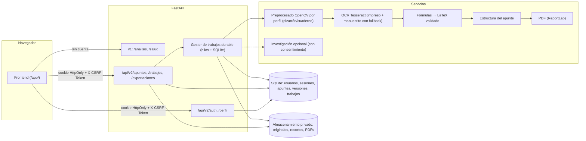
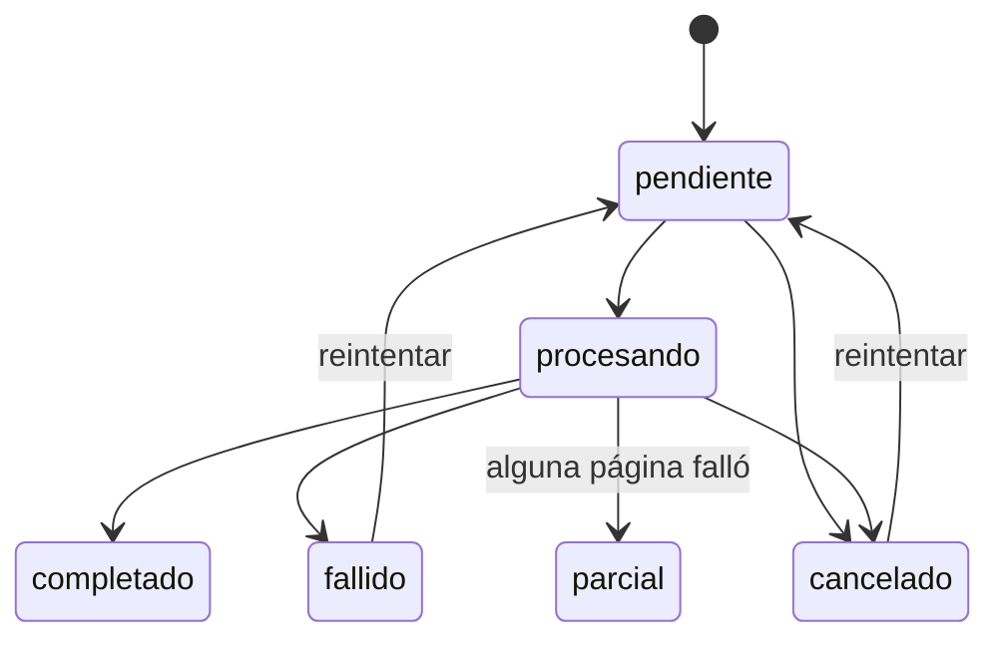

# Contrato de la API v2: apuntes, OCR, fórmulas, PDF y cuentas (FULL-15)

Versión del contrato: **2.0**. Complementa, sin sustituirlo, al contrato v1 ([`api.md`](api.md)).

## 0. Compatibilidad con v1 (no cambia)

| Ruta v1 | Garantía |
|---------|----------|
| `POST /analisis` | Mismo campo `file`, mismos parámetros, misma respuesta `image/png` y mismos errores. Sigue sin cuenta y sin guardar nada |
| `GET /salud` | Mismos campos. Se **añaden** campos nuevos (`ocr`, `base_datos`), nunca se quitan |
| `GET /`, `POST /imagen-memoria` | Sin cambios (la segunda sigue marcada como obsoleta) |
| Errores | Misma estructura `{"error": {"codigo", "mensaje"}}` en v1 y v2 |

Todas las rutas nuevas viven bajo **`/api/v2/`**. La documentación interactiva (`/docs`) muestra ambas versiones.

## 1. Arquitectura



**Mismo origen.** Las cuentas usan una cookie `HttpOnly`, así que la interfaz con cuentas se sirve desde el mismo origen que la API: `http://localhost:8000/app/` en modo script, y detrás de un proxy en Docker. El modo v1 anónimo sigue funcionando desde cualquier origen (`file://`, `:5500`).

## 2. Modelo de dominio

| Entidad | Descripción | Pertenece a |
|---------|-------------|-------------|
| `usuario` | Cuenta: email, nombre, hash de contraseña, preferencias | — |
| `sesion` | Sesión activa (solo se guarda el **hash** del token) | usuario |
| `apunte` | Una nota: título, estado, versión actual | usuario |
| `pagina` | Foto original de una hoja o pizarrón, con su orden y tipo de fuente | apunte |
| `version` | Instantánea inmutable del **documento** (el modelo intermedio, sección 3) | apunte |
| `trabajo` | Tarea larga (análisis, investigación, exportación) con estado persistente | apunte, usuario |
| `exportacion` | PDF generado a partir de una versión concreta | apunte, versión |
| `archivo` | Fichero privado en disco (original, procesado, recorte, PDF), referido por id | usuario |

## 3. Documento: el modelo intermedio editable (BACK-17)

Una única representación JSON, validada y versionada. Separa **lo que hay en la foto** (`origen: "ocr"`), **lo que corrigió el usuario** (`editado: true`, conservando `texto_original`) y **lo que viene de fuera** (`ampliaciones`, nunca mezcladas con los bloques).

```json
{
  "esquema": "apuntia.documento/1",
  "titulo": "Derivadas",
  "paginas": [
    {"id": "p1", "orden": 1, "tipo_fuente": "cuaderno", "archivo_original": "a1", "archivo_procesado": "a2",
     "ancho": 1600, "alto": 1200, "advertencias": ["IMAGEN_BORROSA"]}
  ],
  "bloques": [
    {"id": "b1", "pagina": "p1", "orden": 1, "tipo": "titulo", "bbox": [120, 80, 900, 140],
     "origen": "ocr", "estado": "reconocido", "confianza": 0.93,
     "texto": "Derivadas", "texto_original": "Derivadas", "editado": false},
    {"id": "b2", "pagina": "p1", "orden": 2, "tipo": "formula", "bbox": [120, 300, 800, 380],
     "origen": "ocr", "estado": "incierto", "confianza": 0.61,
     "texto": "f'(x) = lim (f(x+h) - f(x)) / h", "latex": "f'(x) = \\lim \\frac{f(x+h) - f(x)}{h}",
     "latex_valido": true, "recorte": "a3", "editado": false},
    {"id": "b3", "pagina": "p1", "orden": 3, "tipo": "manuscrito", "bbox": [120, 420, 900, 520],
     "origen": "ocr", "estado": "no_reconocido", "confianza": 0.22,
     "texto": "", "recorte": "a4", "editado": false},
    {"id": "b4", "pagina": "p1", "orden": 4, "tipo": "tabla", "origen": "usuario", "estado": "reconocido",
     "tabla": {"encabezados": ["Función", "Derivada"], "filas": [["x^2", "2x"]]}, "editado": true}
  ],
  "ampliaciones": [
    {"id": "x1", "concepto": "Derivada", "texto": "…", "estado": "propuesta",
     "fuente": {"titulo": "Derivada", "url": "https://es.wikipedia.org/wiki/Derivada",
                "proveedor": "wikipedia", "consultado": "2026-11-10T12:00:00Z", "licencia": "CC BY-SA 4.0"}}
  ]
}
```

| Campo | Valores | Regla |
|-------|---------|-------|
| `bloques[].tipo` | `titulo`, `texto`, `manuscrito`, `formula`, `tabla`, `imagen` | Una tabla tiene `tabla`; una imagen tiene `recorte` |
| `bloques[].origen` | `ocr`, `usuario` | Los bloques creados a mano son `usuario` |
| `bloques[].estado` | `reconocido` (confianza ≥ 0.80), `incierto` (0.50–0.80), `no_reconocido` (< 0.50) | Un `no_reconocido` **conserva el recorte** de la imagen y no inventa texto |
| `bloques[].bbox` | `[x0, y0, x1, y1]` en píxeles de la página procesada | Permite resaltar la región en la foto |
| `bloques[].editado` | bool | Si es `true`, el PDF usa `texto`/`latex` del usuario; `texto_original` se conserva |
| `ampliaciones[].estado` | `propuesta`, `aceptada`, `rechazada` | Solo las `aceptadas` van al PDF, en una sección aparte y citadas |

El esquema se rechaza completo si no valida: no se guarda una versión a medias.

**Reglas de procedencia al guardar una edición** (`app/services/documento.py`, `fusionar`):
- En un bloque de OCR, el servidor **conserva** `pagina`, `bbox`, `origen`, `confianza`, `texto_original`, `latex_original` y `recorte` de la versión anterior, aunque el cliente envíe otros valores. `editado` se calcula comparando con el original.
- Un bloque nuevo debe tener `origen: "usuario"`: no se pueden inventar bloques «de la foto».
- De una ampliación solo se puede cambiar `estado`; su texto y su fuente vienen de la investigación. Quitarla del cuerpo no la borra.

## 4. Autenticación y cuenta (BACK-23, BACK-24)

| Método | Ruta | Cuerpo | Respuesta |
|--------|------|--------|-----------|
| `POST` | `/api/v2/auth/registro` | `{email, nombre, password}` | `201 {usuario, csrf}` + cookie de sesión |
| `POST` | `/api/v2/auth/sesion` | `{email, password}` | `200 {usuario, csrf}` + cookie |
| `GET` | `/api/v2/auth/sesion` | — | `200 {usuario, csrf}` o `401` |
| `DELETE` | `/api/v2/auth/sesion` | — | `204`, borra la sesión en el servidor |
| `POST` | `/api/v2/auth/recuperacion` | `{email}` | `202` **siempre** (no revela si la cuenta existe) |
| `POST` | `/api/v2/auth/recuperacion/confirmar` | `{token, password}` | `204`; invalida todas las sesiones |
| `PUT` | `/api/v2/auth/password` | `{actual, nueva}` | `204`; invalida las **demás** sesiones |
| `GET` / `PATCH` | `/api/v2/perfil` | `{nombre?, preferencias?}` | `200 {usuario}` |
| `DELETE` | `/api/v2/perfil` | `{password}` | `204`; borra la cuenta, sus apuntes y sus archivos |

- **Contraseñas:** `scrypt` (N=2¹⁴, r=8, p=1) con sal aleatoria; mínimo 10 caracteres.
- **Sesión:** cookie `apuntia_sesion`, `HttpOnly`, `SameSite=Lax`, `Secure` si `COOKIE_SEGURA=1` (HTTPS); expira tras 12 h sin uso o 7 días en total. En la base solo se guarda el SHA-256 del token.
- **CSRF:** toda petición que modifica (`POST`, `PUT`, `PATCH`, `DELETE`) con cookie lleva la cabecera `X-CSRF-Token` con el valor `csrf` recibido; si no coincide → `403 CSRF_INVALIDO`.
- **Fuerza bruta:** 5 fallos por email o 20 por IP en 15 min → `429 DEMASIADOS_INTENTOS`.
- **Recuperación:** token aleatorio de un solo uso, válido 30 min, guardado como hash. Sin servidor de correo, el enlace se escribe en el **buzón de desarrollo** (`DATA_DIR/buzon/`), nunca en el log.
- **Autorización:** cada consulta filtra por el `usuario_id` de la sesión; un recurso ajeno responde **`404`** (igual que uno inexistente), para no revelar que existe.

## 5. Apuntes, trabajos y exportaciones (BACK-11, 21, 26, 27)

| Método | Ruta | Descripción |
|--------|------|-------------|
| `POST` | `/api/v2/apuntes` | Crea un apunte desde 1–20 fotos. `multipart/form-data`: `paginas` (archivos, en orden), `tipos` (uno por página: `pizarron` o `cuaderno`), `titulo`. Cabecera opcional `Idempotency-Key`. → `202 {apunte, trabajo}` |
| `GET` | `/api/v2/apuntes` | Lista paginada: `?q=&estado=&tipo_fuente=&pagina=1&por_pagina=20&orden=reciente` → `{elementos, total, pagina, por_pagina}` |
| `GET` | `/api/v2/apuntes/{id}` | Apunte con su documento actual y su `version` |
| `PUT` | `/api/v2/apuntes/{id}/documento` | Guarda una versión nueva. Cabecera **`If-Match: <version>`** obligatoria; si otra edición se guardó antes → `409 CONFLICTO_VERSION` con la versión actual |
| `GET` | `/api/v2/apuntes/{id}/versiones` | Historial de versiones |
| `GET` | `/api/v2/apuntes/{id}/versiones/{n}` | Documento de una versión |
| `POST` | `/api/v2/apuntes/{id}/versiones/{n}/restaurar` | Crea una versión nueva igual a la `n` (no borra nada) |
| `DELETE` | `/api/v2/apuntes/{id}` | Borra el apunte, sus versiones, trabajos y archivos |
| `GET` | `/api/v2/apuntes/{id}/archivos/{archivo_id}` | Imagen original, procesada o recorte. Solo el propietario |
| `POST` | `/api/v2/apuntes/{id}/investigacion` | `{consentimiento: true, conceptos: [...]}` → `202 {trabajo}`. Sin `consentimiento: true` → `400 CONSENTIMIENTO_REQUERIDO` |
| `PATCH` | `/api/v2/apuntes/{id}/ampliaciones/{aid}` | `{estado: "aceptada"|"rechazada"}` (crea una versión) |
| `POST` | `/api/v2/apuntes/{id}/exportaciones` | `{version?}` → `202 {exportacion, trabajo}`. Si ya existe un PDF válido de esa versión, lo reutiliza (`200`) |
| `GET` | `/api/v2/apuntes/{id}/exportaciones` | PDFs generados, con la versión de origen |
| `GET` | `/api/v2/exportaciones/{id}/pdf` | Descarga (`application/pdf`, `Content-Disposition: attachment`). Solo el propietario |
| `GET` | `/api/v2/trabajos/{id}` | `{id, tipo, estado, etapa, progreso, error, intentos}` |
| `DELETE` | `/api/v2/trabajos/{id}` | Cancela (`estado: cancelado`) |
| `POST` | `/api/v2/trabajos/{id}/reintentar` | Solo si `fallido` o `cancelado`; reutiliza el mismo trabajo |
| `POST` | `/api/v2/formulas/validar` | `{latex}` → `{valida, errores, vista_previa}` (PNG en base64). No requiere guardar |

### Estados de un trabajo



- `etapa` (dentro de `procesando`): `validando`, `preprocesando`, `ocr`, `formulas`, `estructurando`, `investigando`, `maquetando`.
- `parcial`: el análisis terminó, pero alguna página falló. El documento contiene las páginas buenas y `error` explica cuáles fallaron. **Nunca** es un `completado` con contenido fingido.
- **Durabilidad:** los trabajos viven en SQLite. Si el servidor se reinicia a mitad, al arrancar se vuelven a encolar (máximo 3 intentos).
- **Límites:** `MAX_TRABAJOS_SIMULTANEOS` (2) en el servidor y 3 trabajos pendientes por usuario → `429 DEMASIADOS_TRABAJOS`.
- **Idempotencia:** el mismo `Idempotency-Key` del mismo usuario devuelve el apunte ya creado; exportar dos veces la misma versión devuelve el mismo PDF.

## 6. Errores nuevos

Misma estructura `{"error": {"codigo", "mensaje"}}`, con un campo opcional `detalles` cuando hay varios fallos. Los mensajes son textos en español para el usuario; el frontend puede traducirlos por `codigo`.

| HTTP | `codigo` | Cuándo |
|------|----------|--------|
| 400 | `DATOS_INVALIDOS` | Cuerpo JSON o formulario con campos inválidos |
| 400 | `DOCUMENTO_INVALIDO` | El documento no cumple el esquema (la versión anterior queda intacta) |
| 400 | `DEMASIADAS_PAGINAS` | Más de `MAX_PAGINAS` (20) |
| 400 | `PAGINAS_INVALIDAS` (o el código de la única página que falla) | Alguna foto no es válida. No se guarda nada y `error.detalles` lista `{pagina, codigo, mensaje}` de cada una |
| 400 | `CONSENTIMIENTO_REQUERIDO` | Investigación sin consentimiento explícito |
| 400 | `LATEX_INVALIDO` / `LATEX_NO_PERMITIDO` | LaTeX que no se puede dibujar / con comandos peligrosos |
| 401 | `NO_AUTENTICADO` | Sin sesión o sesión caducada |
| 401 | `CREDENCIALES_INVALIDAS` | Email o contraseña incorrectos (mismo mensaje en ambos casos) |
| 403 | `CSRF_INVALIDO` | Falta o no coincide `X-CSRF-Token` |
| 404 | `NO_ENCONTRADO` | No existe **o no es tuyo** |
| 409 | `EMAIL_EN_USO` | Registro con un email ya usado |
| 409 | `CONFLICTO_VERSION` | `If-Match` no coincide con la versión actual |
| 409 | `TRABAJO_NO_REINTENTABLE` | Reintentar un trabajo que no falló ni se canceló |
| 428 | `VERSION_REQUERIDA` | Falta `If-Match` |
| 429 | `DEMASIADOS_INTENTOS` / `DEMASIADOS_TRABAJOS` | Límites de abuso |
| 503 | `OCR_NO_DISPONIBLE` | Tesseract no está instalado: el análisis falla con este código, no con texto vacío |
| 503 | `INVESTIGACION_NO_DISPONIBLE` | Sin conexión con el proveedor o deshabilitado |

## 7. Privacidad e investigación externa

- Las fotos, el texto y los PDFs **no salen del servidor**, salvo en la investigación opcional.
- La investigación solo envía **los conceptos** elegidos (palabras clave), nunca la foto ni el texto completo, y solo con `consentimiento: true` y la preferencia `investigacion_permitida` del perfil activada.
- Cada ampliación guarda su URL, proveedor, fecha y licencia; si no hay fuente, no se incluye.
- La generación del apunte y del PDF funciona **sin Internet**.

## 8. Diagnóstico (FULL-21)

- `GET /salud`: contrato v1 + `ocr: {disponible, motor, idiomas}` y `base_datos: {disponible}`.
- `GET /api/v2/listo`: `200` si las dependencias obligatorias funcionan; `503` con la lista de las que fallan.
- Cada respuesta lleva `X-ApuntIA-Peticion-Id`, que aparece también en el log. Los errores de trabajos guardan un `error_id` sin datos privados.

## 9. Decisiones

| Decisión | Alternativas evaluadas | Motivo |
|----------|------------------------|--------|
| Rutas `/api/v2/...` y v1 intacto | Cambiar `/analisis` para que devuelva JSON | Rompería a los clientes existentes y las 113 pruebas |
| Sesión con cookie `HttpOnly` + CSRF | JWT en `localStorage` | El token no es accesible desde JavaScript (mitiga XSS); se puede invalidar en el servidor |
| SQLite + carpeta privada | PostgreSQL | Proporcional a un proyecto académico, sin servidor extra; el acceso está aislado en `app/datos/` para poder migrar |
| Tesseract | PaddleOCR, EasyOCR, TrOCR | Apache-2.0, buen español, sin GPU ni descargas de cientos de MB; ver `PROCESAMIENTO.md` |
| Hilos + SQLite para trabajos | Celery + Redis | Sin servicios extra; durable y funciona igual en local y en Docker |
| ReportLab + mathtext | WeasyPrint, LaTeX | ReportLab no necesita librerías del sistema; mathtext dibuja LaTeX **sin ejecutar** un motor TeX |
